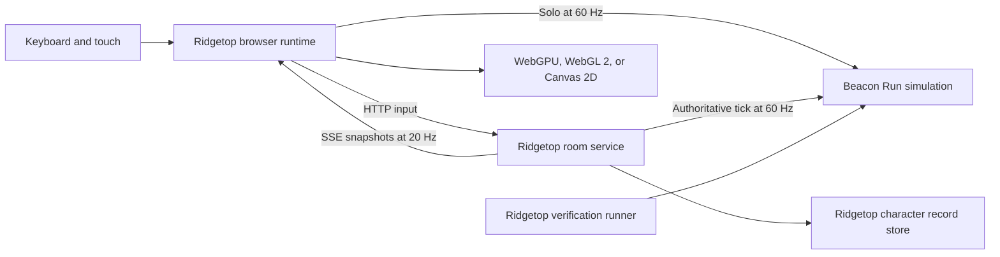

# Ridgetop

Ridgetop is a TypeScript game framework for 2D and low-poly 3D games. It ships with Beacon Run, a multiplayer platformer, and Signal Drift, an original 3D arcade racer. The generated browser modules and server use standard APIs with zero runtime packages.

## Build and run

From a source checkout, run `npm ci` and `npm run build`. The TypeScript compiler emits browser and server ES modules plus declarations into `dist/`. A release archive already contains that output. Choose a server runtime after the build.

| Runtime | Command |
| --- | --- |
| Node 22.18+ | `npm start` or `node dist/server.js` |
| Bun | `bun dist/server.js` |
| Deno | `deno run --allow-net --allow-read --allow-write --allow-env dist/server.js` |

Bun and Deno run the same server through their Node-compatible HTTP and filesystem APIs. The local runtime checks exercised Node 24.22, Bun 1.4.4, and Deno 2.9.6. Use `npm run typecheck` to check all TypeScript sources, including tools and tests. The project currently allows implicit any and uses relaxed null checks. With the development dependencies installed, Bun can invoke the compiler with `bun node_modules/typescript/bin/tsc -p tsconfig.build.json`. Deno can invoke it with `deno run --allow-read --allow-write --allow-env --allow-sys npm:typescript@5.9.3/tsc -p tsconfig.build.json`.

## Play Beacon Run

Start any supported server and open [Beacon Run](http://localhost:3000).

- Move with A/D or the arrow keys. Jump with Space, W, or Up. Touch devices show movement and jump buttons.
- Begin **The Relay Circuit** campaign and restore all six relays across Moss Ridge, Amber Ruins, Frost Summit, Stormworks, Ember Foundry, and Last Light. Each course requires five crystals. The first three unlock a checkpoint. Later courses introduce red contacts and blue launch pads. Jump from a launch pad to gain extra height.
- Optional signal chips and medals reward replaying courses. Gold requires a fall-free run within the course's par time. Silver allows up to two falls. Finishing the sixth unlocked course opens the ending. Best times, medals, recovered chips, and the sound setting persist in your browser.
- Use **Practice** to play any course immediately. Select **Invite players** from a course and share the room link to compare times with up to seven other players. Every player starts their own clock on their first movement or jump. Campaign progress is earned in campaign play. Each course has a separate room.

## Play Signal Drift

Open [Signal Drift](http://localhost:3000/racing) after starting the same server. The orthographic camera keeps an isometric angle on every screen. Desktop shows the full circuit. Narrow screens pan to follow the player.

- Race three AI rivals through Copper Basin, Brineworks, Cinder Switchback, and Midnight Relay. Finish in the top three in the first two events, then in the top two at Cinder Switchback. Win Midnight Relay to take the championship. Replay unlocked events from the schedule.
- Race finishes earn credits. Select a part in the garage to inspect it on the live 3D car and compare the current stats with the next tier. Install up to three tiers each of the motor, tires, shield, and capacitor. The browser saves credits, installed upgrades, records, and event access.

- W or Up accelerates. A/D or Left/Right steer. S or Down brakes and reverses. Hold Space to drift.
- R or **Recover** returns you to the last checkpoint. Touch controls appear on touch devices.
- J fires a pulse straight ahead. K drops a magnetic snare behind the car. Rivals use both weapons. Cyan track pickups replenish ammunition and patch your shield. A car that loses its shield reboots at the previous checkpoint.
- Checkpoints must be crossed in order for a lap to count. Leaving the road reduces grip and speed.

The game uses Ridgetop's spline circuits, arcade driving controller, fixed-step loop, 3D mesh batches, and full-axis rotations. Its four original layouts are rendered as flat driving surfaces in 3D. Car pitch and roll are presentation effects.

## Full stack

Both example games import their own game modules and Ridgetop's public APIs. The framework uses standard browser APIs and the server runtimes' Node-compatible built-ins. The playfield fills the browser viewport. Each game paints its HUD over the playfield and uses HTML overlays for keyboard-accessible menus and touch controls.

| Layer | Ridgetop supplies | Beacon Run supplies |
| --- | --- | --- |
| Browser and controls | `createGamePage`, `createHud`, keyboard and pointer input, clipboard and lifecycle handling, the fixed-step loop, sprite atlases, and a Web Audio synthesizer | HUD design, menus, quest journal, input availability by screen, sprite poses, sound motifs, and artwork |
| Rendering | WebGPU, WebGL 2, and Canvas 2D backends, flat-shaded meshes, hardware instancing where available, culling, and camera projection | Island meshes, course colors, and the placement of terrain, pickups, and characters |
| Simulation | A fixed 60 Hz step and `createPlatformer` for horizontal movement, gravity, jump timing, launch pads, and platform landing | Course geometry, movement constants, hazards, crystals, checkpoints, finish rules, and XP and loot |
| Online play | HTTP hosting, authoritative room ticks, input validation, stream authentication and reconnects, and browser-side snapshot interpolation | Race and expedition routes, region access, quest rewards, and public fields in each snapshot |
| Saves | Browser storage access, anonymous session cookies, and an atomic JSON record store | The campaign save format, character progression, and reward rules |
| Agent verification | Replay checks, bounded exploration, decision evals, and budgeted OpenAI, Clef, Jev, and custom HTTP adapters | Replay fixtures, gameplay invariants, classifier labels, and game-feel probes |



Use `ridgetop` or `./framework/index.js` for the browser and simulation APIs. Use the server entry point `ridgetop/server` for `createGameHost`, `createRoomService`, record storage, and decision adapters. `createRoomService` receives game hooks for player creation, stepping, restart, snapshot serialization, and optional work before publishing. The same Beacon Run simulation runs in solo play, in the server's authoritative rooms, and in verification. The browser sends controls in online mode and interpolates server snapshots for display.

Campaign progress and preferences are stored in the browser. Expedition characters, quest completions, XP, and relics are stored on the server. The framework serves browser modules and an explicit list of game assets. Server modules and character saves stay on the host.

`createHud(canvas)` creates a transparent screen-space layer. Stack its canvas over the playfield, then call `hud.render(renderer.canvas, key, paint)` after rendering the scene. The painter uses CSS-pixel coordinates and matches the current playfield's pixel density. Use a key derived from the visible HUD state so the layer only repaints when that state or the viewport size changes.

## Use the renderer

Import from `ridgetop` when using the package with a resolver, or import directly from `./framework/index.js` on a static site.

```js
import {
  box, color, createLowPolyRenderer, instances, multiply, perspective, view
} from './framework/index.js'

const canvas = document.querySelector('canvas')
const renderer = await createLowPolyRenderer(canvas, {
  lighting: { direction: [-1, 2, 1], ambient: 0.45 }
})

const cliffs = instances(box)
cliffs.add([0, 0, 0], [4, 1, 3], 0, color('#81be91'))
cliffs.add([2.8, 1, 0], [1.4, 0.5, 1.4], Math.PI / 5, color('#a6d7bc'))

const camera = multiply(
  perspective(Math.PI / 3, canvas.clientWidth / canvas.clientHeight, 0.1, 100),
  view([4, 4, 8], [0, 0, 0])
)
renderer.render(camera, [cliffs], color('#22394b'))
```

| API | Contract |
| --- | --- |
| `createLowPolyRenderer(canvas, options)` | Selects WebGPU, then WebGL 2, then Canvas 2D by default. Set `backend` to `webgpu`, `webgl2`, or `canvas` to require that backend at startup. A lost GPU context advances to the next available fallback. Read `renderer.canvas` after recovery because the canvas node can change. `pixelRatio` caps device pixel ratio, default 2. `lighting.direction` points toward the light and is normalized. `lighting.ambient` ranges from 0 to 1. |
| `mesh(positions, indices?)` | Creates a flat-shaded triangle mesh from XYZ positions and optional triangle indices. Use counterclockwise winding when seen from the front. Mesh data is immutable after upload. Built-in meshes include `box`, `cylinder()`, `chamferedPrism()`, and `octahedron`. |
| `instances(mesh, capacity?)` | Owns a reusable batch. Use `add(position, scale, rotation, color, unlit)` with positive scales, RGB components in 0–1, and optional unlit contribution in 0–1. Rotation accepts a yaw angle in radians or an XYZW quaternion. Keep static batches unchanged across frames. Use `clear()` and refill dynamic batches. Group instances by mesh and spatial region for culling. |
| `quaternionFromEuler(pitch, yaw, roll)` and `rotateVec3(rotation, point)` | Build full-axis orientations and transform offsets for attached parts. All three rendering backends use the same orientation convention. |
| `createCircuit(points, subdivisions?)` and `createArcadeDriver(options)` | Sample and project onto a closed XZ route, and step an arcade vehicle with steering, traction, and drift. |
| `renderer.render(viewProjection, batches, clear?)` | Clears and renders an iterable of batches. Matrices are column-major with depth in 0–1. Returns per-frame statistics in a reused object. Triangles count submissions before hardware clipping. `uploadBytes` counts updated instance data. `drawCalls` counts GPU draws or Canvas 2D polygon fills. Use `release(batch)` and `releaseMesh(mesh)` when unloading content and `dispose()` when leaving the game. |
| `fixedLoop({ update, render })` | Runs fixed 60 Hz updates and supplies interpolation alpha and the animation timestamp in milliseconds. Returns a stop function. |
| `createRenderer(canvas, options)` | The original 2D rectangle batching API. |
| `connectRoom({ endpoint, readInput, onStatus })` | A client for the platformer room protocol. Call `flush(now)` and `sample(now)` each frame. The server uses a 60 Hz fixed step and streams snapshots at 20 Hz. |

GPU backends use a depth buffer, back-face culling, and opaque flat directional lighting. Static meshes are uploaded once per renderer. Instance buffers change only when a batch revision changes. Canvas 2D renders the same scene with clipped, depth-sorted polygons. Intersecting geometry can show ordering differences on that backend, and dense scenes should target WebGPU or WebGL 2.

## Server and browser support

`HOST` and `PORT` configure the server. The defaults are `0.0.0.0` and `3000`. `GET /healthz` returns `ok`. For remote play, run one server process behind an HTTPS reverse proxy. Disable proxy buffering for `/rooms/` and `/expeditions/` and allow streaming responses. HTTPS enables WebGPU and clipboard access where supported. An HTTP LAN URL can still use the graphics and sharing fallbacks. Rooms live in memory and reset on server restart. A briefly interrupted event stream can resume the same run for 15 seconds.

The client falls back from WebGPU to WebGL 2 and then Canvas 2D. A Canvas 2D overlay projects the generated sprites into the same game camera on every renderer. Use `?renderer=webgpu`, `?renderer=webgl2`, or `?canvas=1` to exercise explicit backends. Campaign and practice run locally once the app has loaded. Online controls use interpolated server snapshots and do not implement client-side prediction.

The room endpoint is `/rooms/{course}/{room}`. `GET /events` sends a welcome event and then `{ tick, players }` snapshots. `POST /input` accepts `{ left, right, jump, restart }` with the welcome bearer token. `jump` and `restart` are monotonically increasing counters. `POST /leave` removes that participant. The event stream uses `Last-Event-ID` for reconnection.

## Benchmark and release checks

- Open [localhost:3000/benchmark](http://localhost:3000/benchmark). Choose a backend, count, and workload. Static batches measure submission and retained GPU data. Animated batches exercise CPU instance construction and uploads. Results include sample count, draw calls, bytes, CPU median and p95, frame intervals, and a downloadable JSON record. CPU time covers JavaScript and submission. Frame intervals include display cadence and browser scheduling.
- Run `npm test` to verify geometry, culling, all six courses and signal chips, campaign saves, hazards, launch pads, checkpoints, and the room protocol. The room tests bind to a loopback port.
- Run `npm run test:browser` with the game running and Chromium started with `--remote-debugging-port=9222` and a separate `--user-data-dir`. The smoke test covers generated sprite rendering on all three backends, touch controls, context loss where supported, a full six-course Beacon Run campaign and ending, saved progress after reload, two tabs in a room, Signal Drift driving, upgrades and weapons, and both GPU workloads. Override `RIDGETOP_URL` or `CHROMIUM_DEBUG` if needed. `RIDGETOP_BACKENDS` can select available backends.
- Run `npm run test:runtimes` after building to verify Node, Bun, and Deno against static assets, the character save, SSE, and authoritative input. Select a subset with `npm run test:runtimes -- bun deno`. Set `RIDGETOP_BUN` or `RIDGETOP_DENO` if a binary is outside PATH.
- Run `npm pack` after installing the build tools to create the self-hostable release archive. It includes both examples, source, emitted modules, declarations, art, and tests. Extract it and run any server command above inside the `package` directory.

WebGPU and WebGL 2 render the 144-instance static benchmark in two draws and upload zero instance bytes after warm-up. The software-rendered Chromium checks verify behavior. Browser compatibility on Safari and Firefox and performance against Three.js on matched hardware still need validation. Compare equivalent geometry, lighting, instancing, resolution, overdraw, and update rates before drawing conclusions about speed.


## Sprite artwork

The scout and signal chips are original 40×48 pixel sprites generated by `tools/generate-sprites.ts`. Run `npm run generate:sprites` to rebuild the transparent PNG atlas and the scout portrait. Every scout color has idle, run, jump, and fall frames. Beacon Run builds its masonry tiles and scenery from low-poly meshes. Signal Drift uses the same renderer for its triangulated terrain, track markings, and chamfered rally cars. Both games store scenery in retained instance batches and keep moving objects in separate batches. Sprite assets and synthesized Web Audio cues ship with the game and fetch no external content.

## Verification for coding agents

Ridgetop runs the same fixed-step simulation in the browser, on the authoritative server, and in its verification runner. An agent can change a mechanic, run the retained input sequences, and inspect the first violated rule with the state before and after the transition.

```sh
npm run verify
npm run --silent verify -- --json > verification.json
npm run verify -- --replay counterexample.json
```

The JSON report includes the exact input alphabet, tick depth, rule IDs, source-file SHA-256 hashes, and labeled decision scores. When a check fails, save its `replay` object as `counterexample.json`. It carries the course, initial state, and input prefix needed to run the check again. The source hashes identify the implementation and fixtures used for that report.

| Public API | What it establishes |
| --- | --- |
| `verifyTrace({ initial, step, actions, checks, goal })` | A specific input sequence preserves the supplied checks and optionally reaches a goal. The included game replays establish that each course can be completed with its signal chip and without a fall. Separate recovery replays exercise checkpoint respawns. |
| `verifyBounded({ initial, step, alphabet, checks, depth, maxTransitions })` | Every input sequence up to the requested length preserves the checks from that initial state. The first counterexample has a shortest input prefix. Exhausting the budget returns `inconclusive`. Beacon Run checks four ticks from five reachable states per course. |
| `evaluateDecisions({ labels, cases, decide })` | A classifier returns the expected label and cites the required evidence IDs on a labeled fixture. The caller can supply a rule-based decision function or a model adapter. The included runner uses a local reference adapter and requires no credentials or network. |

Both verification functions accept cloneable state and a deterministic synchronous `step(state, action)`. A step can mutate its draft state or return a replacement. Rule callbacks read `{ tick, before, after, action }` and return a Boolean. The initial-state check has tick zero and no action. Rules receive read-only snapshots by contract. Keep clocks, unseeded randomness, and external services out of the model.

A bounded pass applies to the specified starts, actions, tick depth, and rules. It leaves arbitrary-length play, multiplayer transport, and browser rendering outside that claim. Treat rules and fixtures as reviewed inputs when an agent proposes patches. A hash identifies them and can be compared against an independently chosen baseline.

A decision case contains an `id`, an `input` observation, `evidence` entries shaped as `{ id, value }`, and an `expected` answer. The adapter receives the observation and evidence. It returns `{ label, evidence: [id, ...] }`. The evaluator checks labels, required citations, invented IDs, and adapter errors. Keep subjective labels, such as whether a jump feels fair, in a separately labeled eval set with human-reviewed answers.

### Opt in to a decision API

Use the HTTP adapter for small, labeled decisions while the replay and bounded checks run locally. The default `npm run verify` continues to use the local reference classifier. Enable remote requests explicitly with `--decision-api`.

```sh
RIDGETOP_DECISION_URL=https://your-decision-service.example/decide \
  npm run --silent verify -- --decision-api --json
```

Point `RIDGETOP_DECISION_URL` at an endpoint that accepts a JSON POST with `{ labels, rubric, input, evidence }` and returns `{ label, evidence: [id, ...] }`. The endpoint can implement the decision itself or wrap a model. Configure `RIDGETOP_DECISION_TOKEN` in the process environment for optional bearer authentication. Fixture IDs and expected answers stay in the runner.

`RIDGETOP_DECISION_MAX_REQUESTS` bounds HTTP attempts and defaults to three. Identical request bodies share a response within one run. The eight Beacon Run fixtures produce three distinct requests. There are no automatic retries. Requests and responses are capped at 4 KiB each, redirects are rejected, and each attempt times out after eight seconds. The report records attempts, reuse, bytes sent, and cases skipped by the cap. Provider-side model limits and pricing determine the dollar cost.

The same evaluator also connects directly to these providers. Set `RIDGETOP_DECISION_PROVIDER` and supply the selected service's bearer token in `RIDGETOP_DECISION_TOKEN`.

| Provider | Selection | Default model | Additional configuration |
| --- | --- | --- | --- |
| [OpenAI Decisions](https://developers.openai.com/api/docs/guides/decisions) | `openai` | `gpt-6-luna` | |
| [Cloudflare Workers AI Clef](https://developers.cloudflare.com/workers-ai/models/clef-flash/) | `clef` | `clef-flash` | Set `RIDGETOP_DECISION_ACCOUNT_ID`. Model overrides include `clef` and `clef-omni`. |
| [TypeSafe System One](https://api.typesafe.ai/redoc) | `jev` | `jev-latest` | |
| Custom HTTP | `http` (default) | Endpoint-managed | Set `RIDGETOP_DECISION_URL`. |

```sh
RIDGETOP_DECISION_PROVIDER=jev npm run verify -- --decision-api
```

Set `RIDGETOP_DECISION_MODEL` to select a model offered by the chosen native service. Each native adapter batches a label choice and one evidence judgment per supplied item in the same request. A yes probability above 0.5 yields a citation. The evaluator scores the normalized label and citations with the existing answer key and reports the provider and requested model. Request caps, response limits, and deduplication apply to every provider.

### Evaluate game feel

Run `npm run --silent feel` for the jump-timing experiment. It runs the game's fixed-step simulation with candidate coyote-time and jump-buffer windows. Each probe labels an input by intended behavior. A slightly late press after leaving an edge or a slightly early press before landing should jump. A stale press should expire.

The runner ranks candidates on the tuning courses. It gives the selected candidate one pass through separate courses and timings that were held out from ranking. The candidate must accept more intentional inputs on that pass, preserve every previously correct probe, avoid stale jumps, and clear all six retained course replays without falling. The JSON report includes the baseline, proposed settings, each measured input, and replay results. The experiment leaves the shipped timing settings in place.

A broader automated feedback loop can use the same pattern for other mechanics. Give agents a mechanic-specific design brief, have bots with different skill and input habits attempt the same scenarios, and measure consequences such as time to recover from a mistake or completion time by skill level. Use the decision adapters for judgments that need context, such as whether a failure was signaled soon enough for a player to react. Keep the rubric and held-out examples independent of the candidates the agent writes. A promotion step can apply small improvements automatically when they pass both the gameplay contracts and the held-out criteria.

### Wayfarers’ Guild expeditions

Select **Join expedition** to enter the shared world. Each zone has a relay quest and an optional signal chip. Restore a relay to unlock the next zone, collect a relic, and earn 100 XP. A recovered signal chip adds 25 XP. A guild contract adds 60 XP when two distinct characters finish in the same expedition instance and both remain at the relay. Stay at the relay after finishing while your partner catches up. Each reward can be earned once per zone.

The journal shows XP, level, quest status, and relics. Nearby characters appear in the roster. An anonymous browser cookie reconnects you to your character. The server saves characters in `data/characters.json` by default. Set `RIDGETOP_CHARACTER_SAVE` to a file on a persistent volume when hosting. Clearing browser cookies creates a new character the next time you enter. Expedition zones currently support eight players per instance. Solo campaign, practice, and private timed rooms use the existing platforming rules and progress.
