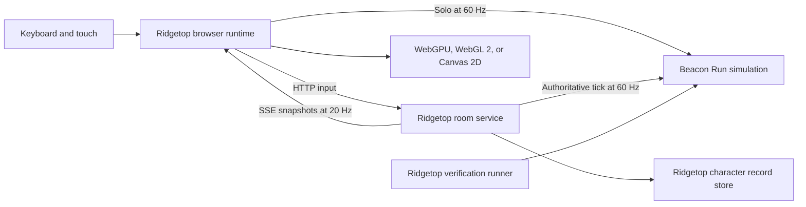

# Ridgetop

Ridgetop is a TypeScript game framework for 2D and low-poly 3D games. It ships with Beacon Run, a multiplayer platformer, and Signal Drift, an original 3D arcade racer. The generated browser modules and server use standard APIs with zero runtime packages.

## Build and run

From a source checkout, run `npm ci` and `npm run build`. The TypeScript compiler emits browser and server ES modules plus declarations into `dist/`. A release archive already contains that output. Choose a server runtime after the build.

| Runtime | Command |
| --- | --- |
| Node 22.18+ | `npm start` or `node dist/server.js` |
| Bun | `bun dist/server.js` |
| Deno | `deno run --allow-net --allow-read --allow-write --allow-env dist/server.js` |

Bun and Deno run the same server through their Node-compatible HTTP and filesystem APIs. The local runtime checks exercised Node 24.22, Bun 1.4.4, and Deno 2.9.6. Use `npm run typecheck` to check all TypeScript sources, including tools and tests. The project currently allows implicit any and uses relaxed null checks. With the development dependencies installed, Bun can invoke the compiler with `bun node_modules/typescript/bin/tsc -p tsconfig.build.json`. Deno can invoke it with `deno run --allow-read --allow-write --allow-env --allow-sys npm:typescript@5.9.3/tsc -p tsconfig.build.json`.

To make artwork, open the [sprite workshop](http://localhost:3000/sprites) on the running server.

For new low-poly game assets, `createArtBuilder` supplies starter bodies, face attachments, endpoint-to-endpoint parts and open handles. It grounds the finished geometry and fits all eight sprites. Generated games include the same builder and a runnable toolbox example. Run `npm run preview-art -- <recipe.art.json>` to check the game's actual sprites and eight larger mesh views before accepting the art. [Art authoring guide](starter/ART.md)

Use `npm run art-library -- list "<description>"` to search 13 editable references, including creatures, equipment and scenery. For example, `npm run art-library -- start field-radio weather-receiver` creates a local copy with named parts ready for a game-specific design.

For live low-poly art, open the [3D model viewer](http://localhost:3000/models), or open `dist/low-poly-models.html` directly after a build. Orbit the headland lighthouse, field ranger, or signal lantern. **Open model file** previews your workshop’s `.art.json` at the canvas resolution. The lighthouse source in `models/headland.ts` shows how to assemble a scene with a custom cliff mesh and instanced props.

Compare how GPT-5.6 Sol, Terra and Luna handled 20 identical low-poly game-art briefs. A follow-up tested the builder, reference library and rendered feedback on the smaller models. [Original blind gallery and trial](benchmarks/asset-authoring/README.md) · [Guided art results](benchmarks/asset-authoring/guided/README.md)

## Start a game of your own

From a prebuilt archive, run the commands below with Node 22.18 or later. From a source checkout, run `npm ci` and `npm run build` first.

```sh
npm run create-game -- ../my-game
cd ../my-game
npm start
```

Open http://localhost:3000. The new project contains a playable collection game, editable ES modules, public type declarations, and an offline copy of the workshop. It needs zero package installs, accounts, API keys, or art downloads. You can also [play the starter in the framework server](http://localhost:3000/starter/).

Open **game/game.js** first. Edit the map, palette, art names, objective text, or the flower recipe and reload. **game/main.js** contains controls, movement, collection, and rendering. A prompt such as “Make the crystals amber, replace the crates with rocks, and add a second route to the lantern” maps to edits in the first file. The view selector lets you play the same state with 2D sprites or live 3D models.

Run `npm run playtest` in the generated game to review art with Codex. In a framework checkout, run `npm run build` first and use the same playtest command to open Lantern Grove. **Pause & inspect** lets you click a visible model part, a 2D sprite or the inventory icon. Move and resize recipe parts directly, or pin a comment to a particular object, shared asset, frame or HUD use. Each thread saves its original image and scene under the game's `reviews/` directory. Codex can edit the referenced source and mark the thread ready. **Reload latest art** restores the saved view for comparison and sign-off. [Starter workflow](starter/README.md#review-the-art-while-playing)

For any game hosted with `createGameHost({ ..., testing: true })` (or `--testing`, such as `npm run start:testing`), Ridgetop automatically injects the game-agnostic Testing Mode bar and In-Game Asset Studio drawer, handles pause/picking across 3D models, rigs, meshes, 2D sprites, and Canvas UI HUD regions, and mounts loopback-only `/__testing/*` endpoints via `createArtReviewHandler` from `ridgetop/art-review/server`. Games may optionally call `registerTestingHooks({ snapshot, restore, getArtSource })` from `ridgetop` to support state rewind on review reload.

| Where the art appears | How to use it |
| --- | --- |
| 3D character, terrain, scenery, pickup or effect | `art.group().add(name, position)` places model parts into shared mesh batches. Retain groups for static scenery. GPU backends apply lighting and depth testing. |
| Directional 2D sprite from a model | `art.sprite(name)` bakes the model's eight views on first use and caches the transparent sheet within the kit. Pass it directly to `createSpriteAtlas`. |
| Hand-drawn sprite or animation | Load a PNG sheet and named-clip manifest. In a generated project, put both files in `game/art/`, set the role's `manifest` and `clip` in `sprites`, and reload the browser. |
| HUD or inventory icon | Draw a selected clip on a small canvas. The starter draws its inventory icon from the pickup's art and displays a spark when the player collects it. |

```js
import { createArtKit, createSpriteAtlas } from './framework/index.js'

const art = createArtKit({ palette: { glow: '#ffb764' } })
const world = art.group()
world.add('pine', [2, 0, -1])
world.add('crystal', [0, 0, 0])
renderer.render(camera, world.batches)

const icon = await createSpriteAtlas(iconCanvas, art.sprite('crystal'))
icon.begin(iconCanvas)
icon.drawClip('front-right', 0, [0, 0], { height: 1, anchor: 0.5 })
```

The included recipes are `ranger`, `tile`, `pine`, `rock`, `crate`, `crystal`, `lantern`, and `spark`. Pass your own `models` to `createArtKit({ models, palette, frameSize })`. Each recipe has a camera `span`, vertical `centerY`, and parts with a mesh, local XYZ position, positive scale, and palette tone. Parts can also specify `yaw` in radians and `unlit` from 0 to 1. Configure the recipes and palette when creating the kit. Geometry and sprite generation use the same part definitions.

To reskin a starter from a file, choose **Ranger** in the workshop and **Save editable model**. Keep its `.art.json` in `game/art/`. In `game/game.js`, set `modelFiles` to `{ ranger: 'art/ranger.art.json' }` and reload. A coding assistant can edit a named part such as `jacket` or `backpack`, or add a part in the same format. The live player and its directional sprites both read the change. Model-specific palette values override the kit for that asset. Other roles inherit the game palette.

New projects include `game/art/rain-ranger.art.json`. Set `modelFiles` to `{ ranger: 'art/rain-ranger.art.json' }` to try a teal raincoat, a brimmed hat, and a roll-top pack with the original ranger’s camera and ground position.

The sprite layer draws flat images in screen space. A projected sprite can follow a world point. Live 3D geometry participates in the scene's depth test. The workshop exports PNG and animation JSON for its pixel art, imported frames, and baked models. Its **Use in your game** panel also shows placement code when an asset has a 3D model.

The offline workshop is generated by the regular build at `dist/sprite-workshop-offline.html`, using Node and the project's existing TypeScript compiler. Double-click the file to use it offline.

## Play Beacon Run

Start any supported server and open [Beacon Run](http://localhost:3000).

- Move with A/D or the arrow keys. Jump with Space, W, or Up. Touch devices show movement and jump buttons.
- Begin **The Relay Circuit** campaign and restore all six relays across Moss Ridge, Amber Ruins, Frost Summit, Stormworks, Ember Foundry, and Last Light. Each course requires five crystals. The first three unlock a checkpoint. Later courses introduce red contacts and blue launch pads. Jump from a launch pad to gain extra height.
- Optional signal chips and medals reward replaying courses. Gold requires a fall-free run within the course's par time. Silver allows up to two falls. Finishing the sixth unlocked course opens the ending. Best times, medals, recovered chips, and the sound setting persist in your browser.
- Use **Practice** to play any course immediately. Select **Invite players** from a course and share the room link to compare times with up to seven other players. Every player starts their own clock on their first movement or jump. Campaign progress is earned in campaign play. Each course has a separate room.

## Play Signal Drift

Open [Signal Drift](http://localhost:3000/racing) after starting the same server. The orthographic camera keeps an isometric angle on every screen. Desktop shows the full circuit. Narrow screens pan to follow the player.

To give a player the single-player racer, run `npm run build` and distribute `dist/signal-drift.html`. Open that file in a modern desktop browser or serve it over HTTPS. Its circuits, art, garage, and synthesized audio are embedded. Players can use **Save backup** on the main menu to download their championship or restore it after a browser change or game update. A restore shows the credits and event count before the player chooses to replace their current progress.

Run `npm run test:player` against local Chromium with remote debugging enabled to check the downloadable file. It opens copies in two temporary browser profiles with networking disabled, drives a race, and transfers a garage upgrade between them. The game server can stay stopped.

- Race three AI rivals through Copper Basin, Brineworks, Cinder Switchback, and Midnight Relay. Finish in the top three in the first two events, then in the top two at Cinder Switchback. Win Midnight Relay to take the championship. Replay unlocked events from the schedule.
- Race finishes earn credits. Select a part in the garage to inspect it on the live 3D car and compare the current stats with the next tier. Install up to three tiers each of the motor, tires, shield, and capacitor. The browser saves credits, installed upgrades, records, and event access.

- W or Up accelerates. A/D or Left/Right steer. S or Down brakes and reverses. Hold Space to drift.
- R or **Recover** returns you to the last checkpoint. Touch controls appear on touch devices.
- J fires a pulse straight ahead. K drops a magnetic snare behind the car. Rivals use both weapons. Cyan track pickups replenish ammunition and patch your shield. A car that loses its shield reboots at the previous checkpoint.
- Checkpoints must be crossed in order for a lap to count. Leaving the road reduces grip and speed.

The game uses Ridgetop's spline circuits, arcade driving controller, fixed-step loop, 3D mesh batches, and full-axis rotations. Its four original layouts are rendered as flat driving surfaces in 3D. Car pitch and roll are presentation effects.

## Full stack

Both example games import their own game modules and Ridgetop's public APIs. The framework uses standard browser APIs and the server runtimes' Node-compatible built-ins. The playfield fills the browser viewport. Each game paints its HUD over the playfield and uses HTML overlays for keyboard-accessible menus and touch controls.

| Layer | Ridgetop supplies | Beacon Run supplies |
| --- | --- | --- |
| Browser and controls | `createGamePage` (query/backend parsing, touch media listeners, disposal registry), `createPlatform`, `createCanvasUi` (with `createHudPainter` underlay, `sync`, and `exposeGlobal`), keyboard, pointer, touch, and gamepad input (`bindActionControls`, `bindPlatformControls`, `bindVirtualStick`), clipboard and unified lifecycle handling, the fixed-step loop, sprite atlases, and a Web Audio synthesizer | HUD design, menus, quest journal, input availability by screen, sprite poses, sound motifs, and artwork |
| Rendering | WebGPU, WebGL 2, and Canvas 2D backends, flat-shaded meshes, hardware instancing where available, culling, and camera projection | Island meshes, course colors, and the placement of terrain, pickups, and characters |
| Simulation | A fixed 60 Hz step and `createPlatformer` for horizontal movement, gravity, jump timing, launch pads, and platform landing | Course geometry, movement constants, hazards, crystals, checkpoints, finish rules, and XP and loot |
| Online play | HTTP hosting, authoritative room ticks, input validation, stream authentication and reconnects, and browser-side snapshot interpolation | Race and expedition routes, region access, quest rewards, and public fields in each snapshot |
| Saves | Browser storage access, anonymous session cookies, and an atomic JSON record store | The campaign save format, character progression, and reward rules |
| Agent verification | Replay checks, bounded exploration, decision evals, and budgeted OpenAI, Clef, Jev, and custom HTTP adapters | Replay fixtures, gameplay invariants, classifier labels, and game-feel probes |



Use `ridgetop` or `./framework/index.js` for the browser and simulation APIs. Use the server entry point `ridgetop/server` for `createGameHost`, `createRoomService`, record storage, and decision adapters. `createRoomService` receives game hooks for player creation, stepping, restart, snapshot serialization, and optional work before publishing. The same Beacon Run simulation runs in solo play, in the server's authoritative rooms, and in verification. The browser sends controls in online mode and interpolates server snapshots for display.

Campaign progress and preferences are stored in the browser. Expedition characters, quest completions, XP, and relics are stored on the server. The framework serves browser modules and an explicit list of game assets. Server modules and character saves stay on the host.

`createHud(canvas)` creates a transparent screen-space layer. Stack its canvas over the playfield, then call `hud.render(renderer.canvas, key, paint)` after rendering the scene. The painter uses CSS-pixel coordinates and matches the current playfield's pixel density. Use a key derived from the visible HUD state so the layer only repaints when that state or the viewport size changes.

## Use the renderer

Import from `ridgetop` when using the package with a resolver, or import directly from `./framework/index.js` on a static site.

```js
import {
  box, color, createLowPolyRenderer, instances, multiply, perspective, view
} from './framework/index.js'

const canvas = document.querySelector('canvas')
const renderer = await createLowPolyRenderer(canvas, {
  lighting: { direction: [-1, 2, 1], ambient: 0.45 }
})

const cliffs = instances(box)
cliffs.add([0, 0, 0], [4, 1, 3], 0, color('#81be91'))
cliffs.add([2.8, 1, 0], [1.4, 0.5, 1.4], Math.PI / 5, color('#a6d7bc'))

const camera = multiply(
  perspective(Math.PI / 3, canvas.clientWidth / canvas.clientHeight, 0.1, 100),
  view([4, 4, 8], [0, 0, 0])
)
renderer.render(camera, [cliffs], color('#22394b'))
```

| API | Contract |
| --- | --- |
| `createLowPolyRenderer(canvas, options)` | Selects WebGPU, then WebGL 2, then Canvas 2D by default. Set `backend` to `webgpu`, `webgl2`, or `canvas` to require that backend at startup. A lost GPU context advances to the next available fallback. Read `renderer.canvas` after recovery because the canvas node can change. `pixelRatio` caps device pixel ratio, default 2. `lighting.direction` points toward the light and is normalized. `lighting.ambient` ranges from 0 to 1. |
| `mesh(positions, indices?)` | Creates a flat-shaded triangle mesh from XYZ positions and optional triangle indices. Use counterclockwise winding when seen from the front. Mesh data is immutable after upload. Built-in meshes include `box`, `cylinder()`, `chamferedPrism()`, `octahedron`, `revolvedMesh()`, `archMesh()`, and `crescentMesh(sweep, inner, outer)` (a tapered double-sided arc ribbon for slash trails and shockwaves). |
| `instances(mesh, capacityOrOptions?)` | Owns a reusable batch. Pass a capacity or `{ capacity?, blend?: 'opaque' | 'alpha' | 'additive' }`. Use `add(position, scale, rotation, color, unlit)` with positive scales, RGB(A) components in 0–1 (fourth component controls opacity for `alpha`/`additive` batches), and optional unlit contribution in 0–1. Rotation accepts a yaw angle in radians or an XYZW quaternion. Keep static batches unchanged across frames. Use `clear()` and refill dynamic batches. Group instances by mesh and spatial region for culling. |
| `createRig(joints)`, `renderRig(...)`, `createAnimator(clips, initial)`, `createParticles()` | Hierarchical 3D forward-kinematics rigs, cross-faded keyframe clip animation with procedural pose layering, mesh batch pools (`createMeshPool`), and 3D velocity/parabolic-arc particles rendered into standard `InstanceBatch`es across all backends. `mirrorClip(clip)` derives the opposite-side variant of an asymmetric clip (swaps `armL/armR` + `legL/legR`, negates yaw, roll, and X), `retimeClip(clip, seconds)` rescales a clip, and particles accept `delay` (hidden until it elapses, for staggered choreography) plus fixed `pitch`/`roll` tilts. |
| `renderer.setLighting({ direction?, ambient?, color?, fogColor?, fogNear?, fogFar?, points? })` | Updates directional light direction/color, ambient level, distance fog, and up to 4 dynamic point lights at runtime across WebGPU, WebGL 2, and Canvas 2D without re-uploading static batches. |
| `quaternionFromEuler(pitch, yaw, roll)` and `rotateVec3(rotation, point)` | Build full-axis orientations and transform offsets for attached parts. All three rendering backends use the same orientation convention. |
| `createCircuit(points, subdivisions?)` and `createArcadeDriver(options)` | Sample and project onto a closed XZ route, and step an arcade vehicle with steering, traction, and drift. |
| `renderer.render(viewProjection, batches, clear?)` | Clears and renders an iterable of batches. Matrices are column-major with depth in 0–1. Returns per-frame statistics in a reused object. Triangles count submissions before hardware clipping. `uploadBytes` counts updated instance data. `drawCalls` counts GPU draws or Canvas 2D polygon fills. Use `release(batch)` and `releaseMesh(mesh)` when unloading content and `dispose()` when leaving the game. |
| `createSoundscape(options)` | Multi-bus Web Audio mixer (`master`, `music`, `sfx`, `ambience`) with looping filtered pink-noise ambience beds (`beds` / `setBed`), filtered `noiseBurst()`, per-bus `tone()`, and live `setMusicFilter()` / `setMusicVolume()`. |
| `bindVirtualStick(element, options)` | Pointer/touch drag thumbstick returning a normalized `{ x, z }` movement vector rotated by `cameraYaw`, with `isBlocked(x, y)` so Canvas UI widgets always take priority. |
| `worldToScreen(matrix, x, y, z, width, height)` | Projects a 3D world point directly to CSS pixels and returns `null` when behind the camera or outside the clip margin. |
| `fixedLoop({ update, render })` | Runs fixed 60 Hz updates and supplies interpolation alpha and the animation timestamp in milliseconds. Returns a stop function. |
| `createRenderer(canvas, options)` | The original 2D rectangle batching API. |
| `connectRoom({ endpoint, readInput, onStatus })` | A client for the platformer room protocol. Call `flush(now)` and `sample(now)` each frame. The server uses a 60 Hz fixed step and streams snapshots at 20 Hz. |

GPU backends use a depth buffer, back-face culling, and opaque flat directional lighting. Static meshes are uploaded once per renderer. Instance buffers change only when a batch revision changes. Canvas 2D normally sorts clipped polygons by depth. For overlapping model parts, set `canvasDepth: true` to depth-test individual pixels on the CPU. This mode writes one image to the canvas per draw and its cost scales with pixel count. The starter enables it for its live Canvas fallback. Sprite baking always uses it.

## Server and browser support

`HOST` and `PORT` configure the server. The defaults are `0.0.0.0` and `3000`. `GET /healthz` returns `ok`. For remote play, run one server process behind an HTTPS reverse proxy. Disable proxy buffering for `/rooms/` and `/expeditions/` and allow streaming responses. HTTPS enables WebGPU and clipboard access where supported. An HTTP LAN URL can still use the graphics and sharing fallbacks. Rooms live in memory and reset on server restart. A briefly interrupted event stream can resume the same run for 15 seconds.

The client falls back from WebGPU to WebGL 2 and then Canvas 2D. A Canvas 2D overlay projects the generated sprites into the same game camera on every renderer. Use `?renderer=webgpu`, `?renderer=webgl2`, or `?canvas=1` to exercise explicit backends. Campaign and practice run locally once the app has loaded. Online controls use interpolated server snapshots and do not implement client-side prediction.

The room endpoint is `/rooms/{course}/{room}`. `GET /events` sends a welcome event and then `{ tick, players }` snapshots. `POST /input` accepts `{ left, right, jump, restart }` with the welcome bearer token. `jump` and `restart` are monotonically increasing counters. `POST /leave` removes that participant. The event stream uses `Last-Event-ID` for reconnection.

## Benchmark and release checks

- Open [localhost:3000/benchmark](http://localhost:3000/benchmark). Choose a backend, count, and workload. Static batches measure submission and retained GPU data. Animated batches exercise CPU instance construction and uploads. Results include sample count, draw calls, bytes, CPU median and p95, frame intervals, and a downloadable JSON record. CPU time covers JavaScript and submission. Frame intervals include display cadence and browser scheduling.
- Run `npm test` to verify geometry, culling, all six courses and signal chips, campaign saves, hazards, launch pads, checkpoints, and the room protocol. The room tests bind to a loopback port.
- Run `npm run test:browser` with the game running and Chromium started with `--remote-debugging-port=9222` and a separate `--user-data-dir`. The smoke test covers generated sprite rendering on all three backends, touch controls, context loss where supported, a full six-course Beacon Run campaign and ending, saved progress after reload, two tabs in a room, Signal Drift driving, upgrades and weapons, and both GPU workloads. Override `RIDGETOP_URL` or `CHROMIUM_DEBUG` if needed. `RIDGETOP_BACKENDS` can select available backends.
- Run `npm run test:review` after a build, with the same Chromium debugging endpoint. It creates a temporary game and exercises part picking, recipe changes, animated sprite regions, HUD feedback and review reopening. Set `RIDGETOP_REVIEW_RENDERER` to `webgpu`, `webgl2` or `canvas`.
- Run `npm run test:runtimes` after building to verify Node, Bun, and Deno against static assets, the character save, SSE, and authoritative input. Select a subset with `npm run test:runtimes -- bun deno`. Set `RIDGETOP_BUN` or `RIDGETOP_DENO` if a binary is outside PATH.
- Run `npm pack` after installing the build tools to create the self-hostable release archive. It includes both examples, source, emitted modules, declarations, art, and tests. Extract it and run any server command above inside the `package` directory.

WebGPU and WebGL 2 render the 144-instance static benchmark in two draws and upload zero instance bytes after warm-up. The software-rendered Chromium checks verify behavior. Browser compatibility on Safari and Firefox and performance against Three.js on matched hardware still need validation. Compare equivalent geometry, lighting, instancing, resolution, overdraw, and update rates before drawing conclusions about speed.

## Preparing a paid game

Signal Drift is the first downloadable single-player example. The framework archive and the editable starter serve developers. Give playtesters the same player build you intend to distribute.

| Priority | Evidence to collect |
| --- | --- |
| Commercial use | Ridgetop is licensed under the [MIT License](LICENSE) for personal and commercial games. Record the source, permissions, and required credits for any third-party imported assets. |
| Art production | Give a new creator a character brief. Have them reopen a workshop recipe, change its silhouette and palette, and regenerate the in-game art and icon. Time the second edit. A shared set of idle and walk poses with aligned feet is the next addition to test. |
| Customer download and updates | Give the player a versioned build, keep the previous release, and exercise a fresh install and an update with an existing save. The racer provides an offline release check and portable garage backups. Extend that path to custom games, including their imported art and audio. |
| Supported devices | Name the browsers, input methods, and minimum hardware you will advertise. Measure cold start, memory over repeated level changes, and 95th-percentile frame time in the busiest playable scene on each target. Test audio and pause/resume after switching away and returning. |
| First-time player | Watch a new player start unaided, learn the controls, finish one event, spend the reward, quit, and find that upgrade on returning. Repeat with the control and sound settings you intend to ship. |

On itch.io, an HTML game can accept donations. For a minimum purchase price on the game download, the platform documents the Downloadable project type. [itch.io HTML game guide](https://itch.io/docs/creators/html5)

### Package for Web, Steam (Desktop / Steam Deck), Mobile (iOS / Android), and Godot (Switch / Consoles)

Ridgetop includes a zero-dependency packager that **tree-shakes only the ES modules your game actually imports** and **drops all studio/authoring/testing artifacts** (`reviews/`, `art/library/`, `testing*.js`, `serve.js`, `art-review.js`, `verification.js`, and unused framework or UI modules). All non-web targets are strictly opt-in:

```sh
# Minimal tree-shaken static web bundle (zero native wrappers, zero studio tools)
npm run package -- --target web --game signal-drift

# Package Signal Drift for Steam (Electron), Mobile (Capacitor), Web, and Godot 4
npm run package -- --target all --game signal-drift

# Export a Godot 4 project (GLB 3D meshes, WAV audio, Control UI scene, joypad map) for Switch / consoles
npm run package -- --target godot --project ../my-game
```

Generated projects created with `npm run create-game` include `npm run package:web`, `npm run package:steam`, `npm run package:mobile`, and `npm run package:godot` directly inside their own `package.json`.

- **Web (`--target web`)**: Clean, tree-shaken static web bundle with zero wrappers and zero studio files.
- **Steam / Desktop (`--target steam`)**: Electron project with a privileged `ridgetop://app/` secure protocol (WebGPU, ES modules, and `fetch()` without a local port), atomic filesystem saves ready for Steam Cloud Auto-Cloud, Steam Deck fullscreen auto-detection, optional `steamworks.js` integration (`steam_appid.txt`, achievements, overlay), `electron-builder.yml` (Win/Mac/Linux/AppImage), and a 512×512 baked `build/icon.png`.
- **Mobile (`--target mobile`)**: Capacitor project with `viewport-fit=cover`, native bridge (`www/ridgetop-mobile-bridge.js`) connecting saves to `@capacitor/preferences`, haptics to `@capacitor/haptics`, lifecycle pause/audio suspend to `@capacitor/app`, orientation lock, and 1024×1024 baked `resources/icon.png` and `resources/splash.png`.
- **Godot 4 (`--target godot`)**: Compiles the game's real TypeScript logic and framework modules directly to GDScript 4 via `tools/ts-to-gd.ts` (`scripts/compiled/*.gd` + `rt.gd`, also runnable standalone via `npm run compile:godot -- <out-dir> <entry.ts>`), exports binary glTF 2.0 (`.glb`) flat-shaded 3D models with linear per-color PBR/emissive materials, offline-baked 16-bit PCM `.wav` sound effects, `data/game.json`, custom `CanvasItem._draw()` low-poly Canvas UI (`scripts/ridgetop_ui.gd` — zero default Godot widgets), and a joypad/Switch-mapped `project.godot` ready for console export templates.

### Cross-platform Canvas UI & Layout SDK (`ridgetop/ui`)

Instead of HTML/CSS menus, Ridgetop ships a zero-dependency Canvas UI and pure-math Layout SDK designed to match your game's low-poly art and run identically across Web, Steam Deck, Mobile, and Godot exports, exposed through a single `ridgetop/ui` entry point:

- `framework/ui-layout.ts` — pure-math `resolveLayout` (`column`, `row`, `overlay`, `boxNode`, `spacerNode`, safe-area insets, zero DOM)
- `framework/ui-canvas.ts` — `createCanvasUi` and `createUiTheme(game.palette)` for faceted low-poly Canvas rendering with unified pointer, touch, keyboard, and gamepad input, plus headless `snapshot()`, `query()`, and `act()` derived directly from interactive layout nodes (`button`, `toggle`, `select`, `slider`)

## Make a sprite

Open the [sprite workshop](http://localhost:3000/sprites) or the generated project's offline `sprite-workshop.html`. Pick the Beacon Run scout or signal chip for pixel art. The 3D choices include Signal Drift's rally car and all eight built-in art models. Edit the palette and click a frame to inspect it. **Frame time** sets the duration of each pose in the selected animation. **Save PNG** exports the transparent sheet. **Save animation JSON** exports its frame dimensions, named animations, and timing. Keep both files together.

The scout includes idle, run, jump, and fall. The chip has a four-frame sparkle. The car uses the same 3D model as the racer. The workshop renders it once from eight directions, so your game can draw a named view such as `front-left` or play the full `turntable`.

**Compare model views** shows the front, right, and back from that same sheet. Add local reference images for visual comparison or switch to silhouettes to check the outline at the target resolution. For any of the eight art-kit models, **Edit model parts** changes the shape, position, size, or color role of one piece. **Save editable model** preserves part names, palette, framing, frame size, and clip timing in a versioned JSON file. Reopen it with **Open editable model**. The PNG and animation JSON are the files for drawing finished sprites.

`createArtRecipe('ranger')` returns an independent editable source. `modelFromArtRecipe(json)` validates it and returns an `ArtModel` for `createArtKit({ models })`. Version 1 supports `box`, `prism`, `cylinder`, `cone`, and `octahedron`. Positions and sizes use world units. The +Z direction faces forward, +Y points up, and a character's origin is at its feet. Keep `span` and `centerY` fixed when comparing variants. Reference images serve as visual guides during authoring.

For your own artwork, choose **Import PNG artwork**. A single image gets a four-frame `hover` and a `still` pose. The exporter adds transparent headroom so the moving sprite stays inside its cell. Select multiple equal-size PNGs for a `loop` in numeric filename order, such as `walk-2.png` before `walk-10.png`. Source pixels retain their size and alpha. The importer supports up to 64 frames, 8192 pixels per sheet edge, and 16 megapixels per sheet.

### Play an exported animation

Put the pair in your game's asset directory. When using `createGameHost`, include both paths in its `files` list. Stack a transparent canvas over the game as Beacon Run does. Load the manifest once, then draw the clip using elapsed milliseconds and a point in normalized screen coordinates.

```js
import { createSpriteAtlas, fixedLoop } from './framework/index.js'

const stage = document.querySelector('#stage')
const layer = document.querySelector('#sprites')
const atlas = await createSpriteAtlas(layer, '/art/scout-sheet.json')

fixedLoop({
  update() {},
  render(alpha, now) {
    atlas.begin(stage)
    atlas.drawClip('run', now, [0, 0], { height: 0.2 })
  }
})
```

`height` is a fraction of the canvas height. Set `flip` to face the opposite direction or override `row` to select a palette row. Pass elapsed time zero to hold the first pose. A clip uses `{ column, row?, frames, frameMs }` and advances horizontally. The manifest resolves its `src` relative to its own URL. Existing callers can also pass `{ src, frameWidth, frameHeight }` directly and use `atlas.draw(column, row, point, options)`.

### Generate art in code

- `createSpriteSheet(frameWidth, frameHeight, columns, rows = 1)` allocates transparent RGBA pixels. Use `sheet.frame(column, row)` to draw rectangles and filled polygons in cell-local coordinates. Read `sheet.pixels`, `sheet.width`, and `sheet.height` from Node or the browser. Beacon Run's palettes and poses live in `game/sprite-art.ts`. Run `npm run generate:sprites` to rebuild its atlas, portrait, and animation JSON.
- `bakeSpriteDirections(batches, { span, center, frameSize, src })` renders a +Z-facing model into eight transparent views in the browser. It returns a sheet canvas as `image` and a matching `manifest`. Set `span` to the square camera width in world units. The default frame is 64 pixels square, centered at the origin with a 30-degree camera elevation. Pass `elevation` in radians or supply the same `lighting` options as the mesh renderer. Baking uses Canvas 2D and works without a GPU adapter.

## Verification for coding agents

Ridgetop runs the same fixed-step simulation in the browser, on the authoritative server, and in its verification runner. An agent can change a mechanic, run the retained input sequences, and inspect the first violated rule with the state before and after the transition.

```sh
npm run verify
npm run --silent verify -- --json > verification.json
npm run verify -- --replay counterexample.json
```

The JSON report includes the exact input alphabet, tick depth, rule IDs, source-file SHA-256 hashes, and labeled decision scores. When a check fails, save its `replay` object as `counterexample.json`. It carries the course, initial state, and input prefix needed to run the check again. The source hashes identify the implementation and fixtures used for that report.

| Public API | What it establishes |
| --- | --- |
| `verifyTrace({ initial, step, actions, checks, goal })` | A specific input sequence preserves the supplied checks and optionally reaches a goal. The included game replays establish that each course can be completed with its signal chip and without a fall. Separate recovery replays exercise checkpoint respawns. |
| `verifyBounded({ initial, step, alphabet, checks, depth, maxTransitions })` | Every input sequence up to the requested length preserves the checks from that initial state. The first counterexample has a shortest input prefix. Exhausting the budget returns `inconclusive`. Beacon Run checks four ticks from five reachable states per course. |
| `evaluateDecisions({ labels, cases, decide })` | A classifier returns the expected label and cites the required evidence IDs on a labeled fixture. The caller can supply a rule-based decision function or a model adapter. The included runner uses a local reference adapter and requires no credentials or network. |

Both verification functions accept cloneable state, deterministic synchronous `step(state, action)` (use `nextRandom(seed)` or `createRng(seed)` instead of `Math.random()`), and checks shaped as `{ id, test({ tick, before, after, action }) => boolean }`. A passing report returns `{ status: 'pass', ... }`. The initial-state check has tick zero and no action. Rules receive read-only snapshots by contract. Keep clocks, unseeded randomness, and external services out of the model.

A bounded pass applies to the specified starts, actions, tick depth, and rules. It leaves arbitrary-length play, multiplayer transport, and browser rendering outside that claim. Treat rules and fixtures as reviewed inputs when an agent proposes patches. A hash identifies them and can be compared against an independently chosen baseline.

A decision case contains an `id`, an `input` observation, `evidence` entries shaped as `{ id, value }`, and an `expected` answer. The adapter receives the observation and evidence. It returns `{ label, evidence: [id, ...] }`. The evaluator checks labels, required citations, invented IDs, and adapter errors. Keep subjective labels, such as whether a jump feels fair, in a separately labeled eval set with human-reviewed answers.

### Opt in to a decision API

Use the HTTP adapter for small, labeled decisions while the replay and bounded checks run locally. The default `npm run verify` continues to use the local reference classifier. Enable remote requests explicitly with `--decision-api`.

```sh
RIDGETOP_DECISION_URL=https://your-decision-service.example/decide \
  npm run --silent verify -- --decision-api --json
```

Point `RIDGETOP_DECISION_URL` at an endpoint that accepts a JSON POST with `{ labels, rubric, input, evidence }` and returns `{ label, evidence: [id, ...] }`. The endpoint can implement the decision itself or wrap a model. Configure `RIDGETOP_DECISION_TOKEN` in the process environment for optional bearer authentication. Fixture IDs and expected answers stay in the runner.

`RIDGETOP_DECISION_MAX_REQUESTS` bounds HTTP attempts and defaults to three. Identical request bodies share a response within one run. The eight Beacon Run fixtures produce three distinct requests. There are no automatic retries. Requests and responses are capped at 4 KiB each, redirects are rejected, and each attempt times out after eight seconds. The report records attempts, reuse, bytes sent, and cases skipped by the cap. Provider-side model limits and pricing determine the dollar cost.

The same evaluator also connects directly to these providers. Set `RIDGETOP_DECISION_PROVIDER` and supply the selected service's bearer token in `RIDGETOP_DECISION_TOKEN`.

| Provider | Selection | Default model | Additional configuration |
| --- | --- | --- | --- |
| [OpenAI Decisions](https://developers.openai.com/api/docs/guides/decisions) | `openai` | `gpt-6-luna` | |
| [Cloudflare Workers AI Clef](https://developers.cloudflare.com/workers-ai/models/clef-flash/) | `clef` | `clef-flash` | Set `RIDGETOP_DECISION_ACCOUNT_ID`. Model overrides include `clef` and `clef-omni`. |
| [TypeSafe System One](https://api.typesafe.ai/redoc) | `jev` | `jev-latest` | |
| Custom HTTP | `http` (default) | Endpoint-managed | Set `RIDGETOP_DECISION_URL`. |

```sh
RIDGETOP_DECISION_PROVIDER=jev npm run verify -- --decision-api
```

Set `RIDGETOP_DECISION_MODEL` to select a model offered by the chosen native service. Each native adapter batches a label choice and one evidence judgment per supplied item in the same request. A yes probability above 0.5 yields a citation. The evaluator scores the normalized label and citations with the existing answer key and reports the provider and requested model. Request caps, response limits, and deduplication apply to every provider.

### Evaluate game feel

Run `npm run --silent feel` for the jump-timing experiment. It runs the game's fixed-step simulation with candidate coyote-time and jump-buffer windows. Each probe labels an input by intended behavior. A slightly late press after leaving an edge or a slightly early press before landing should jump. A stale press should expire.

The runner ranks candidates on the tuning courses. It gives the selected candidate one pass through separate courses and timings that were held out from ranking. The candidate must accept more intentional inputs on that pass, preserve every previously correct probe, avoid stale jumps, and clear all six retained course replays without falling. The JSON report includes the baseline, proposed settings, each measured input, and replay results. The experiment leaves the shipped timing settings in place.

A broader automated feedback loop can use the same pattern for other mechanics. Give agents a mechanic-specific design brief, have bots with different skill and input habits attempt the same scenarios, and measure consequences such as time to recover from a mistake or completion time by skill level. Use the decision adapters for judgments that need context, such as whether a failure was signaled soon enough for a player to react. Keep the rubric and held-out examples independent of the candidates the agent writes. A promotion step can apply small improvements automatically when they pass both the gameplay contracts and the held-out criteria.

### Wayfarers’ Guild expeditions

Select **Join expedition** to enter the shared world. Each zone has a relay quest and an optional signal chip. Restore a relay to unlock the next zone, collect a relic, and earn 100 XP. A recovered signal chip adds 25 XP. A guild contract adds 60 XP when two distinct characters finish in the same expedition instance and both remain at the relay. Stay at the relay after finishing while your partner catches up. Each reward can be earned once per zone.

The journal shows XP, level, quest status, and relics. Nearby characters appear in the roster. An anonymous browser cookie reconnects you to your character. The server saves characters in `data/characters.json` by default. Set `RIDGETOP_CHARACTER_SAVE` to a file on a persistent volume when hosting. Clearing browser cookies creates a new character the next time you enter. Expedition zones currently support eight players per instance. Solo campaign, practice, and private timed rooms use the existing platforming rules and progress.
