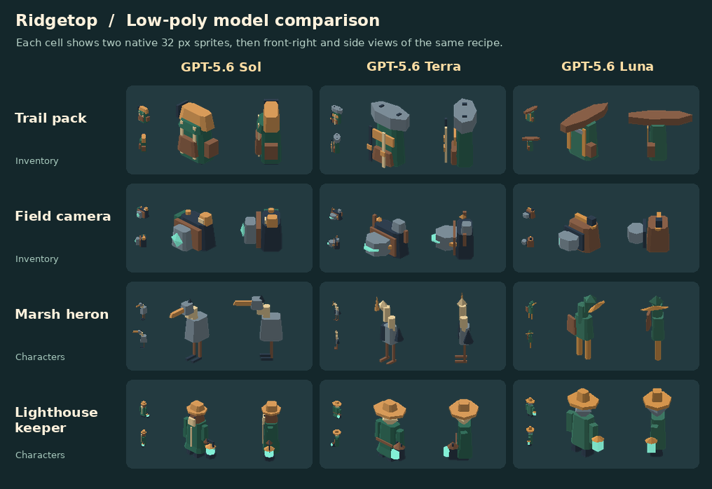

# GPT-5.6 low-poly art trial

Sol produced the most usable first drafts in this run. It passed the blind visual review for 18 of 20 briefs, including all five characters. Terra passed 11 and did particularly well on camp props. Luna passed four. All three made both directed edits precisely.

Download the gallery and open it locally to compare all 60 candidates in eight directions. The trail pack and survey crab have a switch for the revised versions. To inspect the full geometry, extract a recipe and choose **Open model file** in Ridgetop’s 3D viewer. [Offline blind gallery](gallery.html) · [66 original and revised recipes](recipes.zip) · [Scores and render measurements](results.json)

| GPT-5.6 model | Rendered | Passed visual review | Passed technical checks | Passed both on first submission | Exact edits |
| --- | ---: | ---: | ---: | ---: | ---: |
| Sol | 20/20 | 18/20 | 10/20 | 10/20 | 2/2 |
| Terra | 20/20 | 11/20 | 8/20 | 5/20 | 2/2 |
| Luna | 20/20 | 4/20 | 0/20 | 0/20 | 2/2 |



## Where the differences showed up

| Visual passes out of five | Sol | Terra | Luna |
| --- | ---: | ---: | ---: |
| Camp props | 3 | 4 | 1 |
| Inventory | 5 | 3 | 1 |
| World props | 5 | 3 | 2 |
| Characters | 5 | 1 | 0 |

- **Camp stove.** Terra separated the grate, burner, fuel canister and control knob at 32 px. Both Terra’s and Sol’s stoves passed all checks.
- **Marsh heron.** Sol’s bent neck and long horizontal bill read in profile. Terra’s bill looked like a vertical spike, and Luna’s crossed or hung away from the head. Sol’s first submission still touched a sprite edge.
- **Field camera.** All three earned a visual pass. Sol’s grip, viewfinder and lens formed the most coherent assembly around the turn. Luna’s barrel looked separated from its mount in profile.
- **Watering can.** All three missed a requested feature. Two put the grip over the body where the brief called for a handle opposite the spout. The third lost the connection from the spout to the pot.

## What Ridgetop can take off the model’s plate

**Framing.** In the original submissions 33 cameras put an opaque pixel on a frame edge in at least one direction. This was Sol’s only technical issue and cost it eight visually passing assets. An additional renderer experiment increased only the camera span in 5% steps until each view had a clear one-pixel border. All 33 cleared, with a median span increase of 15.8%. First-pass counts above use the submitted cameras. The reframed images received a technical border check only. The optional renderer flag below reproduces this experiment.

**Palette inheritance.** Every Luna recipe wrote out Ridgetop’s eight base colors. The assignment required an empty override object so the game’s leaf, accent and glow colors could propagate into every asset. Five Luna recipes also exceeded the ground-offset tolerance. A project-aware validator can identify both issues before an artist spends time reviewing the shapes.

**Shape placement.** The recipe format supports yaw around the vertical axis. A part specified by two endpoints would give an author a direct way to aim a beak, align a horizontal bedroll or attach a spout. The heron and watering-can briefs are good regression cases for testing that addition.

**Comments on a named part.** After the first submission, every author received its own eight-view render and the same two requests. Each doubled the width of both backpack straps and set their tone to `glow`. Each widened the crab’s main sensor lens by 50% and set its tone to `light`. All six passed a field-by-field comparison and visibly changed at 32 px. Camera, part identity, unrelated geometry and materials were preserved. That makes an inexpensive model worth testing for a precise editor comment even when its first-draft silhouettes need more direction.

## How the trial ran

One subagent of each specified GPT-5.6 model worked at medium reasoning effort on one shared batch. Each received the same twenty short briefs, assignment, starter palette and framework source references. The authors could validate their files. They submitted the first drafts before seeing renders. All meshes were authored from five stock shapes with a 32-part limit. The actual submissions ranged from 5 to 20 parts and from 84 to 422 triangles.

The renderer used the version-1 recipe loader and Ridgetop’s own eight-direction baker, 30-degree elevation, native 32 px frames and separate 128 px mesh views. One AI reviewer scored recognition at game size, fidelity to the brief and construction from multiple angles, each from 0 to 2. A visual pass required 2 for recognition, 2 for fidelity and at least 1 for construction. The submission also had to pass the frame, palette, grounding, naming and part-budget checks to count as accepted. The reviewer recorded all 60 observations under shuffled per-brief labels before opening the model key. [Artist assignment](artist-brief.md) · [All briefs](briefs.json) · [Full scoring protocol](protocol.md)

These are paired observations from one batch per model and one reviewer. The trial covers static assets with a shared low-poly style. A human art-direction review, repeated runs and a comparison without Ridgetop would answer different questions. The subagent runner exposed neither billed usage nor token counts. At the observed first-pass yields, Terra would need to cost less than half as much per 20-brief batch as Sol to have a lower generation cost per accepted first draft. That calculation excludes review time and revisions.

## Replay the renders

Use a built framework checkout and Node 22.18 or later. Extract the submissions, then launch a local Chromium with a separate profile in its own terminal. The benchmark uses the project’s existing browser driver.

```sh
npm run build
unzip benchmarks/asset-authoring/recipes.zip -d /tmp/ridgetop-art-study
chromium --headless --remote-debugging-port=9222 --user-data-dir=/tmp/ridgetop-art-study/chrome about:blank
```

From the checkout in a second terminal, select a model and a submission round. The command produces two PNG sheets per asset and a metrics file. With `--check-framing`, each recipe that touched an edge also gets a 32 px sheet with its adjusted span.

```sh
CHROMIUM_DEBUG=http://127.0.0.1:9222 node benchmarks/asset-authoring/render.mjs \
  /tmp/ridgetop-art-study/gpt-5.6-sol/first /tmp/ridgetop-art-study/sol-renders --check-framing
```

The run used framework commit `0377cce355d4bf02cb2fc74b147f07a86a0ce5c6`. The results file includes the original and revised recipe hashes, frame margins, changed-pixel counts for each requested edit and every blind observation. The gallery verification loaded the single HTML file over loopback, disconnected the browser, exercised all 20 briefs and both revisions, and compared displayed pixels against the engine’s PNGs.
