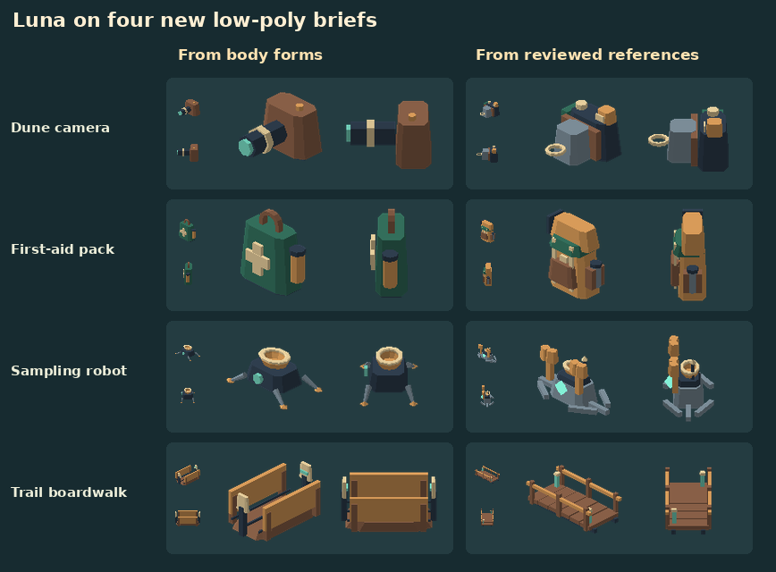
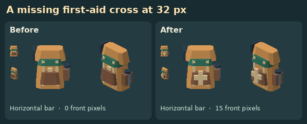

# Can Ridgetop help a smaller model make better art?

The builder solved the recurring framing, grounding and palette problems in this run. It brought Luna from zero accepted first drafts to eight on the same 24 briefs. Both groups passed visual review on eight. A subsequent visual revision raised Luna to nine. The clearer gains were specific to the task and feature.

| Author and workflow | Visually passed | Technically passed | Passed both | Median triangles per asset |
| --- | ---: | ---: | ---: | ---: |
| GPT-5.6 Luna, raw recipes | 8/24 | 0/24 | 0/24 | 120 |
| GPT-5.6 Luna, builder | 8/24 | 24/24 | 8/24 | 280 |
| Same Luna drafts after one visual review | 9/24 | 24/24 | 9/24 | 276 |
| GPT-5.6 Terra, builder | 13/24 | 24/24 | 13/24 | 308 |

Guided Luna made a legible watering can and an open rowboat with a bench and oars. Its fox still had detached ears, and its upright squirrel was hard to identify. After looking at its own renders, Luna changed the pixels of seven assets. The camp stove gained a visible burner and raised grate. The other 17 produced identical views. Triangle counts are geometry measurements. This trial did not measure game frame rate.

## Starting from a reviewed model

Two additional GPT-5.6 Luna runs received four new briefs involving changes to familiar kinds of object. One used the generic body forms. The other could search the 13 reviewed references selected from the earlier trial. All eight first drafts passed the technical checks. All agents stopped before rendered feedback for this comparison.

| New brief | Body forms | Reviewed references |
| --- | --- | --- |
| Dune camera | Passed | The band floated beside the telephoto barrel. |
| First-aid pack | Passed | The pocket obscured the cross. |
| Sampling robot | Passed | Passed |
| Trail boardwalk | High solid sides obscured the open-railed bridge. | Passed |

The reference route passed two of four, compared with three of four from the body forms. Both approaches produced recognizable work, and the better starting point varied with the subject. These four briefs were deliberately chosen within library coverage.

## A correction the framework can explain

The preview command counts the pixels of every named part that survive depth testing. On the reference-based first-aid pack, the horizontal bar of the cross contributed **zero pixels in all eight directions**. We gave Luna that diagnostic and asked for a local correction. Only the two cross parts changed. The repaired horizontal and vertical bars occupy 15 and 18 pixels respectively in the native front sprite. The comparison below shows the same camera before and after. The four-brief table records the original submissions.

## How we tested

- One medium-effort subagent per initial condition authored one batch. Raw Luna worked on the frozen framework at `b4069b4`. Guided Luna and Terra used the builder and the same project palette. The 24 prompts included the original 20 plus a rowboat, reading lamp, squirrel and accordion. On the original 20 alone, raw Luna passed visually on seven, guided Luna on six, and guided Terra on eleven.
- One AI reviewer judged game-size recognition, brief fidelity and 3D construction against the earlier rubric. All first-pass candidates rendered through the real framework at 32 px and 128 px. Labels shuffled independently by brief. All 72 visual ratings were recorded before revealing the labels. Seven changed revisions received a shuffled before-and-after review. Identical renders kept their original scores. [Scoring protocol](../protocol.md)
- The four library-transfer pairs received a separate anonymous review. Catalog entries came from visually passing first drafts in the earlier study. No transfer solution was in the catalog. The visibility correction was a separate, targeted exercise.
- One batch per condition and a single reviewer limit generalization. A mismatched reference can hide a new feature, and technical validity leaves proportions, silhouette and taste open. The runner supplied no billing telemetry.

## Use or replay the submissions

The archive contains all 105 editable submissions, including unchanged revisions and the repaired pack. The JSON records the brief, score, observation, technical checks, original hash and measured part visibility. Extract any recipe and run `npm run preview-art -- <path-to-recipe.art.json>` in the framework or a generated game. The command writes the native sprite strip and eight larger views using the game's palette. The 144 first-pass sheets from the new headless path matched the original Chromium bakes pixel for pixel. [Editable submissions](submissions.zip) · [Full results](results.json) · [Art authoring guide](../../../starter/ART.md)
